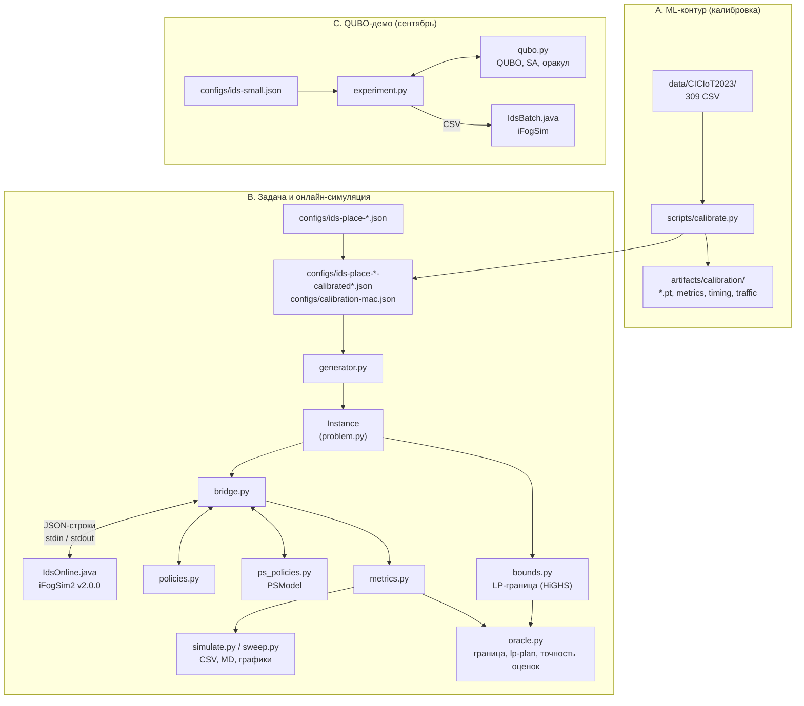

# Архитектура проекта: компоненты, файлы и связи

Состояние на коммит `bcae830` (M5) плюс модель равного деления CPU (`ps_model.py`). Документ описывает техническое устройство: какие
компоненты есть, в каких файлах они лежат, какие данные передают друг другу и где
проходят границы между ML-частью, задачей IDS-PLACE, симуляцией в iFogSim и
QUBO-частью. Научная сторона (гипотезы, результаты, выводы) описана в
[`research-overview.md`](research-overview.md).

---

## 1. Три контура

Проект состоит из трёх контуров. Они **не вызывают друг друга напрямую**, а
обмениваются файлами:



Два момента, которые легко понять неправильно:

1. **Нейросети IDS внутри симуляции не исполняются.** В iFogSim модель — это набор
   чисел из конфига: стоимость окна в MI, recall по классам, доля ложных тревог,
   время холодного старта, память. Веса моделей (`*.pt`) нужны только для того,
   чтобы эти числа *измерить*.
2. **QUBO пока не подключена к онлайн-задаче.** Контур C — отдельный минимальный
   эксперимент: 6 задач, только выбор узла, без моделей. Онлайн-задачу IDS-PLACE
   сейчас решают эвристические политики из `policies.py` и `ps_policies.py`. Новая
   QUBO-политика должна встать на то же место, что и они (раздел 7).

---

## 2. Общий язык: модель задачи

### `src/fogids/problem.py`

Классы данных, которыми пользуются все остальные модули.

| Класс | Поля и методы |
|---|---|
| `Node` | `name`, `tier` (edge/fog/cloud), `parent`, `mips`, `memory_mb`, `uplink_bytes_s`, `uplink_latency_s`, `idle_w`, `busy_w`, `cost_per_gi`, `resident` (модели при старте), `criticality` |
| `Model` | `fixed_mi`, `mi_per_flow` → `work_mi(n) = fixed_mi + mi_per_flow·n`; `memory_mb`; `load_s` (холодный старт); `recall[class]`; `false_positive_rate` |
| `Task` | видно планировщику: `gateway`, `release_s`, `deadline_s`, `n_flows`, `input_bytes`, `prefilter_score`, `criticality`; производные `weight = criticality·(0.1 + score)` и `estimated_benign_flows = n_flows·(1 − score)`. Правда (`attack_flows`, `label`) — только для метрик |
| `Instance` | `eligible(task)` — шлюз и его предки; `path_links`, `transfer_s`, `compute_s` — оценки без очередей; `validate()`; JSON-схема `ids-place/1` (`save`, `load`); `summary()` — нагрузка и размер задачи |

### `src/fogids/generator.py`

Строит `Instance` из конфига, детерминированно по seed.

- `Stream` — генератор случайных чисел только на `random.Random.random()`:
  Пуассон, нормальное и логнормальное распределения, перестановка. Поэтому инстанс
  побайтно одинаков на любой версии Python и ОС. Тест закрепляет SHA-256
  small-инстанса.
- `build_topology` — облако → F fog-узлов → G шлюзов на fog; критичные шлюзы
  выбираются по seed.
- `generate` — для каждого шлюза и окна длиной W = 1 с:
  - фоновый трафик ~ Poisson(rate·W·J);
  - всплески атак с линейным нарастанием (`_burst_overlap`);
  - задача готова в момент `конец окна + feature_s_per_flow·flows`;
  - нарезка на задачи по ≤ 1000 потоков;
  - шумный `prefilter_score`, класс дедлайна (0.3 с или 2 с).

### Конфиги (`configs/`)

| Файл | Назначение |
|---|---|
| `ids-place-{small,medium,large}.json` | базовые сценарии с условными параметрами моделей |
| `ids-place-*-calibrated.json`, `*-x3.json`, `*-x10.json` | калиброванные модели, скорости узлов и интенсивности атак; три масштаба трафика |
| `calibration-mac.json` | профиль калибровки: железо, модели, трафик, источники чисел |
| `ids-small.json` | конфиг QUBO-демо (контур C) |
| `ifogsim.lock.json` | зафиксированная версия iFogSim |

---

## 3. Онлайн-симуляция в iFogSim

### 3.1 Установка и сборка

| Файл | Что делает |
|---|---|
| `scripts/bootstrap.py` | создаёт `.venv`, клонирует iFogSim2 **v2.0.0** (коммит `643c433`) в `vendor/ifogsim/` |
| `scripts/ifogsim.py` | `build()` компилирует upstream (~327 файлов, кодировка ISO-8859-1) в `build/ifogsim/classes/`; `classpath()` собирает классы и jar-файлы upstream |
| `bridge.compile_driver()` | докомпилирует наши `IdsBatch.java` и `IdsOnline.java` поверх upstream, если исходники новее классов |

Исходники upstream не изменяются. `vendor/`, `build/` и `.venv` в Git не хранятся и
воспроизводятся через `bootstrap.py`.

### 3.2 Соответствие сущностей (`java/org/fogids/IdsOnline.java`)

| IDS-PLACE | iFogSim / CloudSim | Настройка |
|---|---|---|
| Узел | `FogDevice` с одним `PowerHost` и **одним PE** | MIPS узла; RAM; `FogLinearPowerModel(busy_w, idle_w)`; интервал обновления CPU 0.01 с |
| Канал к родителю | uplink `FogDevice` | пропускная способность = `uplink_bytes_s`, задержка = `uplink_latency_s`; у корня 1e12 |
| Реплика IDS | `AppModule "ids_<узел>"` | по одной на каждый узел; планировщик `IdsBatch.InferenceScheduler` |
| Задача | `Tuple` (Cloudlet), направление `UP` | длина = `work_mi(n_flows)` (+ `load_s·MIPS` при холодном старте); размер = `input_bytes`; адресат = модуль выбранного узла |
| Передача вверх | очередь uplink `FogDevice` | по одному кортежу за раз: `bytes / bandwidth` + задержка распространения |
| Вычисление | time-sharing CloudSim | задачи на узле делят CPU поровну |
| Резидентность моделей | `touch()` | LRU в пределах `memory_mb`; промах = холодный старт |
| Завершение | `CLOUDLET_RETURN` | `finish_s`; проверка, что задача исполнена на назначенном узле |

**Исправление CPU.** У upstream-класса `TupleScheduler` пустой
`getCurrentRequestedMips()`, поэтому периодическое обновление `PowerHost`
отбирало CPU, и конечный набор задач не завершался. `InferenceScheduler` запрашивает
полный MIPS узла, пока на нём есть задачи, и ноль в простое. Это проверено
аналитическими тестами.

### 3.3 События драйвера

`IdsOnline` — это `SimEntity` с собственными событиями:

| Событие | Когда | Что делает |
|---|---|---|
| `RELEASE` | `release_s` задачи | добавляет задачу в список новых. Отправляется раньше событий эпох, поэтому задача, готовая ровно на границе, попадает в эту эпоху |
| `EPOCH` | k·Δ, Δ = 0.1 с | если есть новые задачи, отправляет снимок и ждёт ответа (`onEpoch`) |
| `APPLY` | эпоха + `delay_s` | создаёт кортежи и отправляет их на шлюз (`onApply`) |
| `CLOUDLET_RETURN` | конец вычисления | фиксирует завершение (`onComplete`) |
| `FINISH` | все задачи завершены, или наступил момент max(горизонт, последняя готовность) + `drain_s` (по умолчанию 30 с) | отправляет итог (`onFinish`) |

### 3.4 Протокол Java ⇄ Python

```mermaid
sequenceDiagram
    participant J as IdsOnline (JVM)
    participant B as bridge.py
    participant P as policy
    Note over J: модельное время t, граница эпохи k
    J->>B: {"type":"epoch","t","epoch","tasks":[id],"completed":[[id,finish]],"nodes":{...}}
    Note over J: JVM заблокирована, время стоит
    B->>P: decide(Snapshot)
    P-->>B: [(id, node, model), ...]
    B->>J: {"assignments":[[id,node,model]],"delay_s":d}
    Note over J: validate(); APPLY через d секунд
    J-->>B: ... следующие эпохи ...
    J->>B: {"type":"end","t","results":[{id,node,model,dispatch_s,finish_s,cold_start}],"energy_j":{...}}
```

- Снимок по каждому узлу: `outstanding` (сколько задач назначено и не завершено) и
  `resident` (модели в порядке LRU).
- `validate()` отклоняет ответ, если хотя бы одна задача не назначена, назначена
  дважды, отправлена на узел вне пути «шлюз → корень» или указана неизвестная модель.
- Весь вывод iFogSim перенаправлен в stderr; stdout занят только протоколом.

### 3.5 Python-сторона

| Файл | Роль |
|---|---|
| `src/fogids/bridge.py` | `simulate(instance, policy, decision_time, drain_s, log_path, timeout_s)`: запускает JVM, читает снимки, собирает `Snapshot`, вызывает `policy.decide()`, измеряет время решения и при необходимости засчитывает его как `delay_s` (`none` / `measured` / число) |
| `src/fogids/policies.py` | интерфейс `Policy.reset(instance)` / `decide(snapshot)`; политики (раздел 3.6); `by_name()` |
| `src/fogids/metrics.py` | `task_rows` — строка на задачу; `summarize` — сводка прогона. Правда используется только здесь |
| `src/fogids/simulate.py` | `fogids simulate`: один инстанс × несколько политик → `summary.json`, CSV по задачам, логи |
| `src/fogids/sweep.py` | `fogids sweep`: конфиги × seed-ы × политики в параллельных процессах; среднее и 95% t-интервал; `runs.csv`, `summary.csv`, `summary.md`, графики |
| `src/fogids/cli.py` | точка входа `fogids`: `doctor`, `build`, `run`, `ids-demo`, `generate`, `describe`, `simulate`, `sweep`, `oracle` |
| `src/fogids/bounds.py` | `fluid_bound(instance)`: LP-релаксация по всему горизонту со знанием будущего (HiGHS через SciPy). Доли задач по вариантам (узел, модель), переменная «отказа» на задачу, ёмкости CPU и uplink на наборе интервалов → нижняя граница пропусков, ложных тревог и пропущенных атак, плюс LP-план |
| `src/fogids/oracle.py` | `fogids oracle`: граница, проигрывание LP-плана (`Planned`, `lp-plan`) и точность оценок политик — Спирмен прогноз/факт, MAE, доля «нарушенных обещаний» (`fidelity`) |
| `src/fogids/ps_model.py` | `PSModel`: копия модели ресурсов симулятора на стороне планировщика — FIFO-каналы и **равное деление CPU**; предсказывает время завершения кандидата и новое время уже размещённых задач. `ps_finish_times`, `ps_sum_of_finish_times` (замкнутая квадратичная форма) |
| `src/fogids/ps_policies.py` | `ps-greedy` (с запасом по дедлайну `slack`) и `Shadow` (решения другой политики, прогнозы `PSModel`) |
| `src/fogids/qubo_place.py` | QUBO эпохи (`build_epoch`, `EpochQubo`: линейные и парные коэффициенты, `to_qubo` с one-hot-штрафом, отжиг с ходами внутри одной задачи) и политика `qubo-ps` с проверкой через `PSModel` и запасным `ps-greedy` |

### 3.6 Политики

| Политика | Правило |
|---|---|
| `edge-light`, `edge-full`, `fog-full`, `cloud-full` | всё на один уровень одной моделью |
| `greedy-finish` | по убыванию веса риска; лучшая модель, чья оценка (передача без очереди + CPU-бэклог) укладывается в дедлайн |
| `edge-adaptive` | только шлюз; лучшая модель, укладывающаяся в дедлайн, иначе самая быстрая |
| `queue-greedy` | как `greedy-finish` по всем узлам, но с оценкой `QueueModel` |
| `risk-split` | короткий дедлайн — самая быстрая модель на шлюзе; остальные — лучшая модель на узле, где задача по прогнозу закончится раньше |
| `random` | случайный допустимый узел и модель (по seed) |

`QueueModel` — внутренняя оценка политики, а не правда симулятора:

- uplink — очередь FIFO (`link_free`);
- CPU — непрерывно убывающий бэклог в MI (`backlog`, `_backlog_at`);
- прогноз холодных стартов по отслеживаемой резидентности;
- методы `estimate()` (время завершения без фиксации) и `commit()` (фиксирует
  решение).

Деление CPU между задачами, пришедшими позже, она не учитывает. Поэтому под
нагрузкой её прогнозы расходятся с симулятором (Спирмен −0.57 при ×10, M5).

`PSModel` (`ps_model.py`) повторяет то, что делает симулятор: на узле с одним PE
CloudSim делит CPU поровну между идущими задачами (проверено: задача 1000 MI в 1.0 с и
200 MI в 1.1 с на 1000 MIPS завершаются в 2.2 и 1.5 с). На тех же решениях
`queue-greedy` корреляция её прогнозов с симулятором 0.89 / 0.87 при ×3 / ×10, ошибка
29 мс вместо 87 / 136 мс. Подробности и результаты `ps-greedy` — в
[`ps-model.md`](ps-model.md).

| Политика (`ps_policies.py`) | Правило |
|---|---|
| `ps-greedy` | как `queue-greedy`, но с оценкой `PSModel`; вариант допустим, только если задача успевает и ни одна уже размещённая на узле задача из-за неё не опаздывает |
| `ps-greedy-s0.1` | то же, но модель кроме самой быстрой должна уложиться в 90 % дедлайна (запас для задач будущих эпох) |

В `policies.by_name` они пока не зарегистрированы; `scripts/ps_eval.py` подключает
их напрямую.

### 3.7 Метрики (`summarize`)

| Метрика | Определение |
|---|---|
| Пропуски дедлайнов | доля задач с задержкой > дедлайна (с допуском 10 мкс); незавершённые считаются пропусками; отдельно для коротких и длинных дедлайнов |
| Задержка | p50 / p95 / p99 / среднее по завершённым задачам; число незавершённых |
| Пропущенные атаки | Σ `attack_flows·(1 − recall)`; у незавершённой задачи — все атакующие потоки; доля, по классам, macro-среднее |
| Ложные тревоги | Σ `benign_flows·FPR` / Σ `benign_flows`; у незавершённой задачи — 0 |
| Энергия edge и fog | `idle·T + (busy − idle)·время занятости` |
| Стоимость облака | MI, исполненные в облаке, × `cost_per_gi` / 1000 |
| Время решения | среднее и максимум на эпоху |

### 3.8 Чего симуляция не моделирует

- передачу тревог вниз и в облако (задержка заканчивается на завершении инференса);
- извлечение признаков как нагрузку на CPU шлюза (только сдвиг времени готовности);
- горизонтальные каналы fog–fog (дерево iFogSim);
- многоядерность (у узла один PE с суммарным MIPS);
- вытеснение и перепланирование задач, которые уже отправлены.

---

## 4. ML-контур: калибровка

Один скрипт `scripts/calibrate.py`, шаги можно запускать по отдельности или все
сразу (`all`).

| Шаг | Функции | Вход → выход |
|---|---|---|
| `prepare` | `prepare`, `file_label`, `label_group` | `data/CICIoT2023/**.csv` → `data/ciciot2023-sample.npz` (+ `.json`). Метка из имени папки; 34 метки → 7 классов + benign; блоки по 200 подряд идущих строк, ≤ 20 000 строк на метку |
| `train` | `build_model`, `_split_blocks`, `Windows`, `train`, `_evaluate` | выборка → `artifacts/calibration/{light,full}.pt`, `*-metrics.json`, `timing_inputs.npy`. Разбиение по блокам; `Windows` собирает контекст из 16 записей и подменяет часть его чужими записями (ρ); recall обнаружения и ложные тревоги, с чистым контекстом и с ρ = 0.5 |
| `time` | `measure` → `probe` в отдельном процессе | модели → `timing.json`. Один поток CPU, окна 1–1000 потоков, медианы, прямая `fixed + per_flow·n` (`fit_linear`), холодный старт, память |
| `traffic` | `traffic` | CSV → `traffic.json`: медиана `Rate/Number` по метке и классу, отношение к benign |
| `configs` | `write_configs`, `calibrated_config`, `offered_load`, `_update_report` | всё выше → `configs/calibration-mac.json`, 9 калиброванных конфигов, раздел результатов в `docs/calibration.md` |

Модели (PyTorch):

- `light` — нормализация (signed log1p + стандартизация) → MLP 39 → 64 → 32 → 8;
- `full` — нормализация → эмбеддинг 39 → 64 для каждой из 16 записей → GRU(64) →
  голова по [состояние GRU, эмбеддинг самой записи] → 8 классов.

**Стык с остальным проектом** — только поля конфига:

| Поле конфига | Откуда | Кто читает |
|---|---|---|
| `models[].fixed_mi`, `mi_per_flow` | `time` × `ref_mips` | генератор → `Model.work_mi` → длина кортежа в Java, оценки политик |
| `models[].load_s`, `memory_mb` | `time` | Java (холодный старт, LRU), `QueueModel` |
| `models[].recall`, `false_positive_rate` | `train` (ρ = 0.5) | метрики; ранжирование моделей в политиках |
| `topology.edge/fog.mips` | `HARDWARE` (Geekbench) × `ref_mips` | генератор → `FogDevice` |
| `traffic.bytes_per_flow` | 4 × число признаков | размер кортежа → время передачи |
| `attacks[].flows_per_s`, `traffic.benign_flows_per_s` | `traffic` × масштаб нагрузки | генератор → число и размер задач |

---

## 5. QUBO-контур (минимальный демо)

| Файл | Содержимое |
|---|---|
| `src/fogids/qubo.py` | `Qubo` — верхнетреугольные коэффициенты и смещение, `square()` раскрывает квадратичный штраф, `energy()`; `costs()` — суррогат (задержка без очередей, опоздание, парный прокси конкуренции); `greedy()` → допустимое решение U; `slack_weights()` и `build()` — one-hot + бюджет узла через slack, штраф P = U + 1; `encode/decode`; `anneal()` — Metropolis SA на чистом Python; `exact()` — перебор 3^N |
| `src/fogids/experiment.py` | `fogids ids-demo`: greedy и QUBO + SA, с задержкой на решение и без; пишет `nodes.csv` / `tasks.csv`, запускает `IdsBatch`, собирает `summary.json` |
| `java/org/fogids/IdsBatch.java` | пакетный драйвер iFogSim: цепочка edge → fog → cloud, все задачи стартуют разом (с учётом задержки решения); содержит `InferenceScheduler`, который использует и `IdsOnline` |

Чем демо отличается от IDS-PLACE: нет выбора модели, нет онлайна и эпох, нет
дерева, суррогат не знает очередей на каналах. Из демо взяты главная находка
(суррогат почти не коррелирует с симуляцией) и шаблон кодирования ограничений.

---

## 6. Тесты (`tests/`, 68 тестов)

| Файл | Тестов | Что проверяет | Нужен iFogSim |
|---|---|---|---|
| `test_qubo.py` | 5 | раскрытие QUBO на всех битовых строках, равенство стоимостей, slack, воспроизводимость SA | нет |
| `test_ifogsim.py` | 5 | `IdsBatch` против аналитических времён: вычисление, передача, общий CPU, задержка решения, незавершённые | да |
| `test_online.py` | 9 | `IdsOnline`: эпохи, передача + вычисление, общий CPU, холодный старт один раз, задержка, снимок, отказ на неверном назначении, детерминизм | да |
| `test_problem.py` | 5 | допустимость узлов, передача, холодный старт, вес риска, валидация | нет |
| `test_generator.py` | 10 | детерминизм и SHA-256, Пуассон, всплески, нарезка, конфиги | нет |
| `test_metrics.py` | 3 | ложные тревоги и macro; тяжёлая модель снижает обе ошибки; незавершённая задача | нет |
| `test_policies.py` | 7 | `QueueModel` и политики M3 | нет |
| `test_sweep.py` | 3 | агрегация, интервалы; один прогон целиком | частично |
| `test_calibration.py` | 5 | метки, подгонка прямой, калиброванные конфиги, блоки и окна контекста | нет (numpy для одного) |
| `test_oracle.py` | 5 | граница на простых случаях, граница не выше простых назначений, Спирмен, нарушенные обещания | нет (SciPy) |
| `test_qubo_place.py` | 4 | коэффициенты CPU = сумма времён при равном делении; QUBO с one-hot-штрафом = энергия на допустимых назначениях; отжиг находит точный оптимум малой эпохи; прогон в симуляторе | частично |
| `test_ps_model.py` | 7 | равное деление CPU против аналитики, замкнутая форма против симуляции и как квадратичная форма, `PSModel` против симулятора, `ps-greedy` | частично |

Запуск: `python -m unittest discover -s tests`.

---

## 7. Куда встанет новый решатель

Новая QUBO-политика — это класс с тем же интерфейсом, что и бейзлайны:

```
reset(instance)        # статические данные: дерево, модели, MIPS, каналы
decide(snapshot) ->    # [(task_id, node, model)] для всех snapshot.tasks
```

Что у неё есть на входе:

- из `Snapshot` — новые задачи (видимые поля `Task`), завершения, `outstanding` и
  `resident` по узлам;
- из `Instance` — допустимые узлы, пути и каналы, MIPS, параметры моделей;
- из `PSModel` — состояние каналов и уже идущих задач на каждом узле к моменту
  решения (оставшаяся работа, задачи в пути); из него берутся коэффициенты QUBO.

Внутри: построить QUBO эпохи (one-hot по парам (узел, модель); стоимость CPU — точная
форма равного деления Σ a·y + 2·Σ min(aᵢ, aⱼ)·yᵢyⱼ плюс линейные члены от уже идущих
задач; члены для общих каналов; слагаемые для пропущенных атак, ложных тревог с весом λ
и стоимости облака), решить её отжигом в пределах бюджета времени, проверить
допустимость и при неудаче вернуть решение бейзлайна. Подключение — одна строка в
`NAMED` в `policies.py` (зона Windows) или отдельный модуль, который регистрирует
политику. Время решения честно засчитывается через `--decision-time measured`.

---

## 8. Карта файлов

```
README.md                    обзор, установка, проверенные прогоны
pyproject.toml               пакет fogids; extras: calibration (torch, numpy, pandas), analysis (matplotlib)
configs/                     сценарии, калиброванные конфиги, профиль калибровки, lock iFogSim
docs/
  research-overview.md       научный обзор работы (рус.)
  architecture.md            этот документ
  ids-place.md               спецификация IDS-PLACE + результаты M2–M5
  ps-model.md                модель равного деления CPU и ps-greedy: метод и результаты
  ids-minimal.md             QUBO-демо: формулы и допущения (рус.)
  calibration.md             калибровка M4: метод и результаты
  figures/                   графики M3
java/org/fogids/
  IdsOnline.java             онлайн-драйвер по эпохам
  IdsBatch.java              пакетный драйвер QUBO-демо + InferenceScheduler
scripts/
  bootstrap.py               окружение и iFogSim
  ifogsim.py                 сборка и запуск upstream
  calibrate.py               калибровка на CICIoT2023
  ps_eval.py                 оценка PSModel и ps-greedy (seeds × нагрузки)
src/fogids/
  problem.py, generator.py   модель задачи и генератор
  bridge.py                  связь с JVM
  policies.py                политики и QueueModel
  metrics.py                 метрики
  simulate.py, sweep.py      прогоны
  bounds.py, oracle.py       LP-граница, lp-plan, точность оценок (M5)
  ps_model.py, ps_policies.py  модель равного деления CPU, ps-greedy
  qubo_place.py              QUBO эпохи и политика qubo-ps
  qubo.py, experiment.py     QUBO-демо
  cli.py                     команда fogids
tests/                       68 тестов
papers/                      статьи для обзора литературы
(не в Git) data/, artifacts/, vendor/ifogsim/, build/, .venv/, tmp/
```
