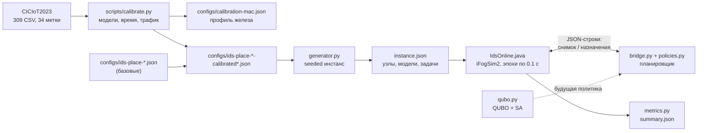

# Обзор проделанной работы: IDS-PLACE

Состояние на 5 октября 2026 года, коммит `73a0236` ветки `main`. Документ сводит в одно
целое то, что разбросано по [`README.md`](../README.md), [`ids-minimal.md`](ids-minimal.md),
[`ids-place.md`](ids-place.md) и [`calibration.md`](calibration.md): что сделано, как
сделано, почему именно так и как части связаны между собой. Для каждого утверждения
указан статус:

- **[сделано]** — реализовано в коде и проверено тестами или прогонами;
- **[измерено]** — численный результат, полученный на реальных данных или в симуляторе;
- **[гипотеза]** — теоретическое утверждение или план, ещё не реализованный в коде.

---

## 1. Задача и научный вопрос

**Прикладная задача.** IoT-трафик проходит через шлюзы (edge), над ними стоят fog-узлы,
над всеми — облако. Система обнаружения вторжений (IDS) на основе нейросети должна
проверять каждое окно трафика. Во время атаки трафик резко растёт, и шлюз может не успевать.
Каждые 100 мс планировщик решает для каждого окна: **где** запускать инференс (шлюз, fog или
облако) и **какой моделью** (лёгкой или полной). Компромисс — между задержкой обнаружения,
качеством обнаружения, энергией и стоимостью облака. Эта задача названа **IDS-PLACE**.

**Научный вопрос.** В работах по планированию через QUBO и (квантовый или
квантово-вдохновлённый) отжиг, включая Q-GARS ([arXiv:2603.23127](https://arxiv.org/abs/2603.23127)),
целевая функция QUBO составляется вручную и не сверяется с тем, что реально происходит
в системе. Наш прототип показал, что такой ручной суррогат почти не связан с исходом
симуляции (раздел 3.4). Отсюда основная линия работы: **сделать QUBO-модель верной
реальности** — вывести её структуру из теории очередей и выучить её коэффициенты по
качеству итоговых расписаний (decision-focused learning), а не задавать их руками.

---

## 2. Общая схема



Три слоя работы связаны так:

1. **ML-слой** (CICIoT2023 → две IDS-модели) даёт параметры, которые планировщик
   обменивает друг на друга: стоимость инференса и качество обнаружения каждой модели.
2. **Слой задачи** (генератор) превращает эти параметры, вместе с топологией и
   моделью трафика с всплесками атак, в воспроизводимые инстансы.
3. **Слой симуляции** (iFogSim) исполняет решения любого планировщика с реальными
   очередями на каналах и разделением CPU и даёт «истину», с которой сверяется
   суррогатная модель оптимизатора.

Оптимизационный слой (QUBO) пока существует как отдельный минимальный эксперимент
(раздел 3) и станет онлайн-политикой на следующем этапе.

---

## 3. Комбинаторная оптимизация: минимальный QUBO-эксперимент [сделано]

Код: [`qubo.py`](../src/fogids/qubo.py), [`experiment.py`](../src/fogids/experiment.py),
[`IdsBatch.java`](../java/org/fogids/IdsBatch.java). Подробные уравнения:
[`ids-minimal.md`](ids-minimal.md).

### 3.1 Модель

Один пакет из N готовых окон признаков (по умолчанию N = 6), три узла в цепочке
edge → fog → cloud. Бинарная переменная `y[i,m] = 1`, если окно i идёт на узел m.

Ограничения:

- каждое окно назначено ровно одному узлу: Σ_m y[i,m] = 1;
- бюджет работы узла: Σ_i d_i · y[i,m] ≤ C_m, где d_i — работа окна в целых единицах
  по 1000 MI, C_m — целый бюджет узла (проверяется u · C_m ≤ MIPS_m · H, H = 2 с).

Прогноз задержки без очередей:
`ℓ̂[i,m] = Σ_{каналы пути} (latency_e + bytes_i / bandwidth_e) + u · d_i / MIPS_m`.

Суррогатная цель (все коэффициенты неотрицательны):

- линейная часть `c[i,m] = w_i · (ℓ̂[i,m] + α · max(0, ℓ̂[i,m] − D_i))` — задержка и
  взвешенное опоздание относительно дедлайна D_i;
- парная часть `h[i,j,m] = β · (w_i + w_j) · u · min(d_i, d_j) / MIPS_m` — грубый прокси
  конкуренции двух окон за один CPU;
- `f(y) = Σ c[i,m] · y[i,m] + Σ_m Σ_{i<j} h[i,j,m] · y[i,m] · y[j,m]`.

Неравенство бюджета превращается в равенство с целочисленным slack `s_m ∈ [0, C_m]`,
закодированным ограниченным набором двоичных весов (для C = 4 это веса [1, 2, 1]:
представимы все числа 0…4 и только они). Итоговая QUBO:

`E(y, s) = f(y) + P · Σ_i (Σ_m y[i,m] − 1)² + P · Σ_m (Σ_i d_i · y[i,m] + s_m − C_m)²`.

Квадраты раскрываются с учётом x² = x и хранятся как верхнетреугольная матрица со
смещением.

**Что взято из Q-GARS и что изменено.** Взят паттерн квадратичных штрафов. В Q-GARS
переменная назначает задаче *ранг*, и два one-hot-штрафа кодируют перестановку. У нас
переменная назначает задаче *узел*; на одном узле может быть несколько окон, поэтому
второй штраф перестановки переносить нельзя — он был бы ошибкой.

### 3.2 Штраф с проверяемым достаточным условием

Динамический штраф Q-GARS выведен для перестановок, и для нашей задачи его
корректность не доказана. Поэтому используется простое достаточное условие:

1. жадный алгоритм строит допустимое назначение со стоимостью U;
2. берётся P = U + 1;
3. все коэффициенты f неотрицательны, а у любого нарушения ограничений целочисленный
   остаток не меньше 1, значит его энергия E ≥ P > U;
4. допустимая кодировка со стоимостью U существует, значит **глобальный минимум QUBO
   всегда допустим**.

Это не гарантирует, что отжиг найдёт этот минимум. Поэтому результат декодируется и
проверяется, а допустимое жадное решение остаётся запасным вариантом.

### 3.3 Решатель и проверка

- Классический Metropolis-отжиг (SA) на чистом Python с фиксированным seed. Один из
  запусков стартует с жадного решения, остальные — со случайных битов.
- Точный оракул перебирает все 3^N назначений и оценивает тот же суррогат. Он нужен для
  проверки, а не для выбора результата.
- Тесты: раскрытие QUBO совпадает с исходной формой на всех битовых строках малого
  инстанса; на всех допустимых назначениях стоимость QUBO равна исходной цели; slack
  покрывает ровно нужный диапазон; SA воспроизводим при одном seed.
- Назначения исполняются в iFogSim (`IdsBatch`) в четырёх режимах: greedy и QUBO + SA,
  каждый без задержки на решение и с измеренной задержкой, которая сдвигает отправку окон
  в модельном времени.

### 3.4 Что показал эксперимент [измерено]

- **Суррогат почти не предсказывает исход.** Все 48 допустимых назначений демо-инстанса
  прогнаны в iFogSim. Корреляция Спирмена между суррогатом и числом пропущенных дедлайнов
  0.01, со взвешенной задержкой — 0.13. Назначение без пропусков существует, но по
  суррогату стоит на 15-м месте из 48; оптимум суррогата пропускает один дедлайн.
  Причина — суррогат не моделирует общие очереди на uplink-каналах.
- **Время решения съедает выигрыш.** SA на Python занимает 0.35–0.5 с. Если честно
  засчитать это время в модельные часы, QUBO + SA пропускает все 6 дедлайнов.
- **Один инстанс ничего не доказывает.** Часть окон завершается ровно на дедлайне,
  и задержка 0.15 мс меняет число пропусков с 5 до 6.
- **SA не воспроизводим между версиями Python** при одном seed (Linux 3.11 и Windows 3.14
  дали разные решения). Для генератора инстансов это уже исправлено (раздел 4).

Отсюда главный вывод, на котором строится дальнейшая работа: **задача не в том, чтобы
быстрее минимизировать QUBO, а в том, чтобы QUBO описывала реальность**.

---

## 4. Постановка IDS-PLACE и генератор инстансов [сделано]

Код: [`problem.py`](../src/fogids/problem.py), [`generator.py`](../src/fogids/generator.py).
Спецификация: [`ids-place.md`](ids-place.md). Постановка зафиксирована до разработки
решателей, чтобы методы сравнивались на замороженном бенчмарке, а не задача подгонялась
под метод.

### 4.1 Система

- **Топология** — дерево: облако, F fog-узлов, по G шлюзов на каждый fog. У узла есть
  скорость (MIPS), память, мощность в простое и под нагрузкой, цена облака за 1000 MI,
  канал к родителю (пропускная способность в байтах/с и задержка).
- **Конвейер.** Трафик шлюза режется на окна длиной W = 1 с. Признаки считаются на шлюзе.
  Размещается **только инференс IDS**.
- **Модели** k ∈ {light, full}: работа `fixed_mi_k + mi_per_flow_k · flows`, память,
  время холодного старта `load_k`, recall по каждому классу атак.

### 4.2 Задачи

Задача — одно окно (или его часть до `max_flows_per_task` = 1000 потоков). Планировщик
видит время готовности, шлюз, число потоков, размер, дедлайн, шумную оценку
пре-фильтра (prefilter score) и критичность шлюза. Истинная метка и число атакующих
потоков используются **только** в метриках.

- Вес риска: `w_i = criticality_i · (0.1 + prefilter_score_i)`.
- Класс дедлайна: короткий (0.3 с), если score ≥ 0.5, иначе длинный (2 с).

### 4.3 Решения и цель

Время делится на эпохи Δ = 0.1 с. В конце эпохи для каждой новой задачи выбирается пара
(узел, модель): `y[i, m, k] = 1`. Допустимые узлы — сам шлюз и его предки. Цель
(взвешенная сумма):

1. задержка обнаружения с учётом риска `Σ w_i T_i`, где T_i — время от готовности до
   завершения инференса, включая очереди на каналах и разделение CPU;
2. ожидаемые пропущенные атаки `Σ w_i (1 − recall_k[class_i])`;
3. энергия edge и fog и стоимость облака.

### 4.4 Генератор трафика

- Фоновый трафик шлюза: Poisson(rate · W · J) потоков за окно, J — логнормальный шум
  с единичным средним.
- Каждый всплеск атаки добавляет Poisson(flows_per_s · overlap) потоков, где overlap —
  перекрытие окна с всплеском с линейным нарастанием. Всплеск бьёт по seeded-подмножеству
  шлюзов. Окна разных шлюзов сдвинуты по фазе.
- Score пре-фильтра = доля атакующих потоков + гауссов шум, обрезанный до [0, 1].
- **Воспроизводимость:** вся случайность строится только на `random.Random.random()`
  (единственный метод с гарантированно одинаковым выходом во всех версиях Python),
  числа округляются до 9 знаков. Тест закрепляет SHA-256 малого инстанса; он совпадает
  на Python 3.10–3.14 и на Linux, macOS, Windows.

Базовые размеры: small (2 fog × 4 шлюза, 30 с, 350 задач), medium (4 × 8, 60 с,
2 700 задач), large (8 × 16, 60 с, 10 783 задачи).

---

## 5. Симуляция в iFogSim [сделано]

Код: [`IdsOnline.java`](../java/org/fogids/IdsOnline.java), [`bridge.py`](../src/fogids/bridge.py),
[`policies.py`](../src/fogids/policies.py), [`metrics.py`](../src/fogids/metrics.py).

### 5.1 Почему и как

iFogSim2 закреплён на версии v2.0.0 (коммит `643c433`, Java 17): более новый upstream
требует API Java 21. Используются настоящие сущности iFogSim (`FogDevice`, `AppModule`,
`Tuple`): передача по uplink идёт через очереди iFogSim, вычисления — через
time-sharing CloudSim. Это и есть «истина», которой не хватает суррогатам.

**Онлайн-протокол.** Java-драйвер строит дерево узлов инстанса и просыпается на каждой
границе эпохи. Если с прошлой эпохи появились задачи, он отправляет в stdout одну
JSON-строку со снимком состояния (новые задачи, завершённые задачи, число незавершённых
задач и резидентные модели на каждом узле) и ждёт ответа на stdin. Пока Python думает,
модельное время стоит. Ответ — назначения и задержка решения `delay_s`. Время решения
можно засчитывать в модельные часы (`--decision-time none | measured | <секунды>`): так
честно учитывается цена медленного оптимизатора.

**Правила драйвера:** каждая задача назначается ровно один раз, только на свой шлюз или
его предка, известной моделью. Холодный старт моделируется как `load_s` секунд
дополнительной работы CPU. Резидентность моделей — LRU в пределах памяти узла.

**Исправление в CPU-модели.** У закреплённого `TupleScheduler` пустой метод
`getCurrentRequestedMips()`, из-за чего периодическое обновление `PowerHost` отбирало CPU
и задачи не завершались. Локальный `InferenceScheduler` запрашивает полный CPU узла, пока
есть работа, и ноль в простое; внутри узла CPU делится стандартным time-sharing.
Исходники upstream не менялись.

**Проверка.** Интеграционные тесты сравнивают симулятор с аналитическими временами:
одиночное вычисление, передача в облако плюс вычисление, два окна на одном CPU,
холодный старт оплачивается один раз, задержка решения, границы эпох, снимок
состояния, отказ на недопустимом назначении. Всего в репозитории 39 тестов.

### 5.2 Базовые политики и метрики
- `edge-light`, `fog-full`, `cloud-full` — всё на один уровень одной моделью.
- `greedy-finish` — задачи по убыванию веса риска; для каждой берётся лучшая модель,
  чья оценка задержки (передача без очередей + накопленная работа узла + своя работа +
  холодный старт) укладывается в дедлайн; если ни одна не укладывается — самая быстрая
  пара. Намеренно простой и прозрачный бейзлайн.

Метрики (истинные метки используются только здесь): доля пропущенных дедлайнов по
классам дедлайна; p50/p95/p99 задержки по завершённым задачам вместе с числом
незавершённых; ожидаемая доля пропущенных атакующих потоков; энергия edge и fog по
линейной модели мощности; стоимость облака; время решения.

Первые результаты на условных (некалиброванных) параметрах [измерено]:

| Инстанс | Политика | Пропуски (все) | Пропуски (короткий дедлайн) | p95, с | Не завершено |
|---|---|---|---|---|---|
| small | edge-light | 0.431 | 0.981 | 2.29 | 0 |
| small | cloud-full | 0.429 | 0.974 | 2.98 | 0 |
| small | greedy-finish | 0.346 | 0.786 | 0.66 | 0 |
| medium | cloud-full | 0.875 | 0.998 | 63.0 | 899 |
| medium | greedy-finish | 0.247 | 0.601 | 0.64 | 0 |

Результат small/greedy-finish совпал при повторе на macOS (0.346 / 0.786 / 0.655).

---

## 6. ML-слой: IDS-модели на CICIoT2023 [сделано, измерено]

Код: [`scripts/calibrate.py`](../scripts/calibrate.py). Подробности: [`calibration.md`](calibration.md).

### 6.1 Данные

CICIoT2023, выпуск 2024 года: одна папка на метку, 309 файлов `*.pcap.csv`, 39 признаков,
колонки `label` нет — метка берётся из имени папки. Каждая строка агрегирует окно пакетов
(`Number` = 10, а для DDoS, DoS и Mirai — 100) и в IDS-PLACE играет роль одного «потока».
34 метки сведены в 7 классов атак и benign: ddos, dos, mirai, recon, spoofing, web,
bruteforce.

Данные сильно несбалансированы, поэтому берётся не больше 20 000 строк на каждую
исходную метку: редкие метки входят целиком (например, Uploading_Attack — 1 252 строки).
Итог — 559 800 строк.

### 6.2 Версия 1: модели на одной записи и найденный потолок

- `light` — MLP 39 → 64 → 32 → 8; `full` — 1D-CNN + LSTM по вектору признаков одной записи.
- Результат: CNN-LSTM при 9× параметров **не точнее** MLP (balanced accuracy 0.727 и 0.728,
  ложные тревоги на benign около 28%).
- Проверка потолка: градиентный бустинг на той же выборке даёт 0.767 (0.732 без
  `Time_To_Live` и `IAT`). Значит, обе сети упёрлись в информацию одной записи, а не в
  ёмкость модели. Подозрение на утечку через TTL и IAT проверено: эффект небольшой.
- Следствие для IDS-PLACE: если тяжёлая модель не лучше лёгкой, разумный планировщик
  всегда выбирает лёгкую, и ось «выбор модели» вырождается.

### 6.3 Версия 2: контекстная модель

**Идея.** Сложные классы (recon, spoofing, web, bruteforce) по одной записи похожи на
benign, но различимы по последовательности записей. Строки внутри файла идут в порядке
захвата: соседние строки заметно ближе друг к другу в пространстве признаков, чем
случайные пары.

**Модель `full`.** На вход — сама запись и 15 предыдущих из того же захвата. Каждая
запись эмбеддится (39 → 64), GRU (64) проходит по 16 эмбеддингам, голова (128 → 64 → 8)
читает финальное состояние GRU вместе с эмбеддингом самой записи. `light` остаётся MLP
по одной записи.

**Защита от завышенных оценок:**

- **выборка блоками** по 200 подряд идущих строк, а не случайными строками;
- **разбиение 70/15/15 по целым блокам** внутри каждого класса, чтобы соседние записи не
  попадали одновременно в обучение и в тест (иначе контекст «подсматривал» бы тест);
- обе модели обучаются и оцениваются на одних и тех же целевых записях;
- **смешанный трафик:** на шлюзе трафик разных хостов перемешан, поэтому при обучении
  каждая запись контекста (но не сама проверяемая) с вероятностью ρ ~ U(0, 0.5)
  заменяется случайной записью любого класса. Модель оценивается дважды: с чистым
  контекстом и с половиной чужого (ρ = 0.5). **В конфиги идёт вторая, осторожная оценка.**

**Recall для симулятора** — это recall *обнаружения*: доля потоков класса атаки, которые
модель отнесла к *любому* классу атаки. Перепутать два класса атак не страшно, тревога
всё равно поднимается; именно так считает метрика пропущенных атак.

### 6.4 Результаты [измерено]

Тестовые блоки, Apple M2:

| | Balanced acc. | Ложные тревоги на benign | recon | spoofing | web | bruteforce |
|---|---|---|---|---|---|---|
| light | 0.716 | 25.6% | 0.855 | 0.850 | 0.871 | 0.857 |
| full, чистый контекст | 0.866 | 10.6% | 0.871 | 0.905 | 0.968 | 0.950 |
| full, половина контекста чужая | **0.804** | **12.7%** | 0.844 | 0.863 | 0.917 | 0.909 |

ddos, dos и mirai обе модели ловят на ~100%. Главный выигрыш `full` — вдвое меньше ложных
тревог; recall растёт умеренно. Предварительная проверка длины контекста (подвыборка, один файл на метку, чистый
контекст): 4 записи дают 0.80, 16 — 0.89, 32 — 0.90, поэтому выбрано 16.

### 6.5 Стоимость инференса [измерено]

Каждая модель замеряется в отдельном процессе на одном потоке CPU, на окнах из 1–1000
потоков (батч = окно; у `full` каждый поток несёт свои 16 записей контекста). По медианам
строится прямая `время = fixed + per_flow · flows`:

| | fixed | на поток | окно 1000 потоков | R² |
|---|---|---|---|---|
| light | 25.7 мкс | 0.149 мкс | 0.17 мс | 0.993 |
| full | 161 мкс | 12.3 мкс | 12.7 мс | 0.999 |

`full` дороже в ~73 раза. Перевод в единицы симулятора: работа [MI] = секунды на одном
ядре M2 × 8000 MIPS (это ядро принято за эталон).

---

## 7. Калибровка нагрузки [сделано, измерено]

### 7.1 Скорости узлов

Относительно эталонного ядра M2, по Geekbench 5 (cpu-monkey.com):

| Уровень | Устройство | Доля ядра M2 | MIPS |
|---|---|---|---|
| edge | Raspberry Pi 4 B, 4 ядра Cortex-A72 | 0.32 | 2 566 |
| fog | Apple M2 целиком, 8 ядер | 4.72 | 37 793 |
| cloud | как в базовых конфигах | 8.0 | 64 000 |

Это прокси: PyTorch на M2 может использовать матричный блок, поэтому на реальном Pi
инференс может быть медленнее, чем показывает соотношение бенчмарков.

### 7.2 Интенсивность трафика

У каждой строки есть скорость пакетов `Rate` и число пакетов `Number`; `Rate / Number` —
записи в секунду. Медиана по меткам и классам, относительно benign (все 309 файлов):

| ddos | dos | spoofing | mirai | recon | bruteforce | web |
|---|---|---|---|---|---|---|
| 15.8× | 12.3× | 3.4× | 2.8× | 1.2× | 0.6× | 0.4× |

В калиброванных конфигах каждый всплеск получает `flows_per_s = benign_flows_per_s × ratio(класса)`.

### 7.3 Масштаб нагрузки как ось эксперимента

Абсолютный объём трафика на шлюз из данных не извлекается, а именно он определяет, есть
ли вообще что оптимизировать. Подгонять его под нужный результат значило бы подстраивать
бенчмарк под метод. Поэтому генерируются конфиги для трёх масштабов (×1, ×3, ×10), и
результаты нужно приводить **как функцию масштаба**. Пиковая односекундная загрузка
(medium, все задачи считаются `full`):

| Масштаб | Задач | Шлюз считает всё сам | Fog, если отдать ему всё |
|---|---|---|---|
| ×1 | 2 753 | 0.22 | 0.07 |
| ×3 | 5 306 | 1.19 | 0.25 |
| ×10 | 15 908 | 3.89 | 0.83 |

При ×1 задача тривиальна (всё делается `full` на шлюзе). С ×3 шлюз во время всплеска не
справляется, и появляется настоящий компромисс: перейти на `light` (хуже качество),
отправить в fog (сетевая задержка, около 0.13 с на окно в 1000 потоков) или в облако
(деньги). При ×10 к пределу подходит и fog.

---

## 8. Как всё связано: цепочка аргумента

1. **Ручной суррогат QUBO не описывает систему** (Спирмен 0.01, §3.4). Это мотивирует
   работу целиком.
2. Чтобы проверить, *что* должен учитывать суррогат, нужна честная «истина»: отсюда
   онлайн-симуляция в iFogSim с очередями, разделением CPU, холодными стартами и
   засчитываемым временем решения (§5).
3. Чтобы истина была не произвольной, параметры взяты из данных и железа: модели
   обучены на CICIoT2023, их время замерено, скорости узлов и интенсивность атак
   откалиброваны (§6–7).
4. Калибровка выявила две вещи, которые иначе прошли бы незамеченными: тяжёлая модель на
   одной записи бесполезна (поэтому `full` стала контекстной), а без высокой нагрузки
   планировать нечего (поэтому масштаб нагрузки — ось эксперимента).
5. На этом фундаменте строится решатель (§9): QUBO, структура которой выведена из
   теории очередей, коэффициенты которой выучены по качеству расписаний в симуляторе, с
   гарантированным запасным вариантом.

---

## 9. Математические гипотезы и план решателя [гипотеза]

Пункты этого раздела ещё не реализованы в коде.

### 9.1 Лемма: «размещение + оптимальное деление CPU» сводится к QUBO

Пусть на узле одновременно обслуживаются задачи с работой a_i (в секундах исключительного
CPU), и CPU делится в постоянных долях θ_i, Σθ_i = 1 (fluid-модель, доли не
перераспределяются при завершении задач). Тогда время задачи равно a_i / θ_i, и
суммарная задержка на узле — Σ a_i / θ_i.

Минимум по θ ищется методом Лагранжа: ∂/∂θ_i (Σ a_j/θ_j + λ Σ θ_j) = −a_i/θ_i² + λ = 0,
откуда θ_i ∝ √a_i и

`min_θ Σ a_i / θ_i = (Σ_i √a_i)²`.

Если задача i попадает на узел только при y_i = 1, стоимость узла равна (Σ_i y_i √a_i)².
Раскрывая квадрат с учётом y_i² = y_i:

`(Σ y_i √a_i)² = Σ_i a_i y_i + 2 Σ_{i<j} √(a_i a_j) y_i y_j`

— это **точная квадратичная форма от бинарных переменных**, то есть QUBO, без
аппроксимации. Значит, совместную задачу «куда поставить + как поделить CPU» в
fluid-модели можно решать отжигом точно, а не через эвристический парный штраф, как
в §3.1.

Оговорки: fluid-модель с постоянными долями не оптимальна относительно последовательного
обслуживания (например, по правилу WSPT); сетевые очереди в лемму не входят и требуют
отдельного члена.

### 9.2 Замечание к Q-GARS

По нашему прочтению статьи, Q-GARS выбирает доли CPU максимизацией log-utility Σ w_i log θ_i, что даёт θ_i ∝ w_i.
По §9.1 оптимум их же целевой Σ q_i / θ_i достигается при θ_i ∝ √q_i. Значит, их
распределение ресурсов не минимизирует их собственную целевую функцию, кроме частного
случая q_i ∝ w_i².

### 9.3 Decision-focused learning коэффициентов QUBO

Вместо подбора коэффициентов суррогата по MSE (точность прогноза задержки) их учат по
качеству итогового расписания в симуляторе. Отжиг участвует в обучении: градиент
берётся через его сэмплы (perturbed optimizers), а структура модели (какие члены есть в
QUBO) задаётся теорией очередей (§9.1 плюс сетевые очереди).

Предварительный результат из отдельного эксперимента, ещё не зафиксированный в
репозитории: если добавить в ту же квадратичную форму очереди на общих каналах,
корреляция со взвешенной задержкой поднимается с 0.13 до 0.67.

### 9.4 Надёжность

- **Hedge** (экспоненциальные веса) применяется только к долям CPU внутри узла: там
  выпуклая смесь допустима и работает неравенство Йенсена.
- На **дискретном размещении** смесь недопустима, поэтому — выбор эксперта плюс жёсткий
  fallback на классический планировщик, если решение отжига недопустимо или не уложилось
  в бюджет времени.
- Регрет формулируется честно — относительно суррогата. Гарантии Q-GARS на наш случай
  автоматически не переносятся.

### 9.5 Эксперименты, которые нужно поставить

- **Ablation штрафов:** динамический штраф Q-GARS (max marginal cost), наш P = U + 1,
  unbalanced penalization.
- **Критерий остановки:** если DFL не обгоняет QUBO, коэффициенты которой выучены простой
  регрессией, основой статьи становятся выученная / queue-aware QUBO и диагностика
  fidelity суррогата.

---

## 10. Ограничения и открытые вопросы

- **Ложные тревоги не входят в метрики симулятора.** Главный выигрыш `full` (12.7%
  против 25.6%) пока невидим ни планировщику, ни результатам.
- Скорости узлов — прокси по бенчмаркам; замер на реальном Raspberry Pi дал бы второй
  профиль железа.
- Контекст берётся из одного захвата; замена половины контекста — приближение к
  перемешанному трафику шлюза, а не его модель.
- Стоимость извлечения признаков на шлюзе не измерена (`feature_s_per_flow` условный).
- SA на чистом Python медленный (0.35–0.5 с) и не воспроизводим между версиями Python;
  нужен быстрый решатель и бюджет времени на эпоху.
- При ×1 QUBO за эпоху мала (пик 126 переменных на medium); вероятно, стоит разрешить
  перепланирование назначенных, но не начатых задач.
- Fog-to-fog выгрузка отложена: дерево iFogSim не содержит горизонтальных каналов.
- Large ×10 — около 60 000 задач, время симуляции нужно учитывать.
- В `calibration.md` два абзаца (о том, какие поля меняются, и о соотношении скоростей
  узлов 1 : ¼ : 8) описывают состояние до калибровки узлов и трафика; актуальные значения
  — в разделах «Node speeds» и «Traffic intensity» того же файла.

---

## 11. Где что лежит

| Путь | Содержание |
|---|---|
| `src/fogids/qubo.py`, `experiment.py` | QUBO, slack, штраф, SA, оракул, демо |
| `src/fogids/problem.py`, `generator.py` | модель IDS-PLACE и seeded-генератор |
| `java/org/fogids/IdsBatch.java` | пакетный драйвер iFogSim (демо QUBO) |
| `java/org/fogids/IdsOnline.java` | онлайн-драйвер по эпохам |
| `src/fogids/bridge.py`, `policies.py`, `metrics.py`, `simulate.py` | мост, политики, метрики, CLI |
| `scripts/calibrate.py` | данные, модели, тайминги, трафик, конфиги |
| `configs/ids-place-*.json` | базовые конфиги (условные параметры) |
| `configs/ids-place-*-calibrated{,-x3,-x10}.json` | калиброванные конфиги, три масштаба нагрузки |
| `configs/calibration-mac.json` | профиль: железо, модели, трафик |
| `docs/ids-minimal.md`, `ids-place.md`, `calibration.md` | подробные описания частей |
| `tests/` | 39 тестов |

Воспроизведение:

```bash
python scripts/bootstrap.py && source .venv/bin/activate
python -m unittest discover -s tests
fogids ids-demo                                             # QUBO-демо (§3)
fogids simulate --config configs/ids-place-medium-calibrated-x3.json
pip install -e '.[calibration]'                             # для §6–7, CICIoT2023 в data/CICIoT2023/
python scripts/calibrate.py all --profile mac
```
